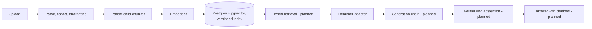

# Prod RAG Tool

A production-grade retrieval-augmented generation (RAG) system, built in the open, milestone by milestone.
The goal: answers that always carry citations, strict multi-tenant isolation enforced inside the database
query, guardrails with explicit refusals, and evals that gate every change.

> **Status: v0.1 Foundation.** This is a foundation milestone, not a working RAG product.
>
> - **Works today:** the local Docker stack, the database schema, document parsing, PII redaction,
>   quarantine, chunking, embedder and reranker adapters, the API contract, the eval harness and CI gates.
> - **Does not exist yet:** an end-to-end ingest pipeline, retrieval, answer generation, the answer
>   verifier, authentication and the web UI. You cannot upload a document and ask it a question.
>
> Component-by-component state, ticket list and design rationale: [docs/status.md](docs/status.md).

## What exists today

- **Compose stack** (`compose.yaml`): `api`, a placeholder `worker`, Postgres 16 with pgvector 0.8, Redis and
  MLflow; optional Prometheus and Grafana (`obs` profile) and Ollama (`llm` profile).
- **Versioned schema** (Alembic): row-level security on every tenant table (a catalogue test fails if a
  tenant table lacks it), separate database roles, `chunks` and `parent_chunks` list-partitioned by index
  version, and a hash-chained append-only audit log written only through a security-definer function.
  The tables exist; nothing populates them yet.
- **Parent-child chunking** (`pc-300-1200-v1`): about 300-token children are embedded, about 1200-token
  parents are returned. See [ADR-0005](docs/decisions/ADR-0005-parent-child-chunking.md).
- **Parsers, PII redaction and quarantine** for text, Markdown, HTML and PDF (no OCR). Structured PII is
  redacted before indexing; unparseable, scanned, oversize or injection-flagged files are quarantined.
  See [docs/ingest-safety.md](docs/ingest-safety.md).
- **Embedder and reranker adapters:** `BAAI/bge-small-en-v1.5` via fastembed (384 dims), a deterministic hash
  embedder for tests, and a cross-encoder reranker adapter (not used by any retrieval path yet).
- **Pipeline policy gate** ([ADR-0006](docs/decisions/ADR-0006-pipeline-policy-gate.md)): policy model, state
  machine, gate rules, MLflow mirror with outbox, SQL tables and repository are built and tested; wiring into
  an ingest worker is not (that worker does not exist yet).
- **OpenAPI v1 contract** with an error envelope, fixtures and snapshot test. Routes are stubs that return
  `501`. See [docs/api-contract.md](docs/api-contract.md) and
  [ADR-0004](docs/decisions/ADR-0004-api-contract-and-versioning.md).
- **Eval harness:** deterministic smoke suite, fail-closed gates, hard-zero metrics, a case-level regression
  check and a synthetic corpus. See [evals/README.md](evals/README.md).
- **CI gates:** lint, type check, tests, security scan, PR hygiene and an eval gate workflow.

## What is not built yet

Ingest pipeline (worker, idempotency, index build, alias swap, rollback), hybrid retrieval, generation chain,
verifier, guardrails, authentication and RBAC, trace writer and dashboards, and the web console. These are
planned and tracked in [docs/status.md](docs/status.md); nothing in this list should be assumed to work.

## Quick start

Requires Docker (Compose v2). Python tooling uses [uv](https://docs.astral.sh/uv/).

```bash
make doctor     # check Docker, free ports and config
make up         # start the core stack (fake provider, no model calls)
make migrate    # apply the database schema (as the owner role)
make urls       # print the URL of every running service
make up-obs     # add Prometheus and Grafana
make down       # stop the stack
make clean      # stop and remove volumes
```

`make migrate` applies the schema as the owner role; the application connects as `rag_svc`.
Ports and `BIND_ADDR` come from the shell or from a `.env` file; copy `.env.example` to start. On macOS,
ports 5000 (AirPlay Receiver) and 11434 may already be taken. Set `MLFLOW_PORT` and `OLLAMA_PORT` in `.env`
to free ports, then run `make doctor` again. Variables are described in [docs/running.md](docs/running.md).
`make up-llm` adds Ollama (optional, local models).

Python side, no containers needed:

```bash
uv sync                # install pinned dependencies
make verify            # ruff check and pytest
make test              # pytest
make eval              # deterministic smoke eval suite
make status            # refresh generated blocks in docs/status.md
make contract-update   # regenerate the OpenAPI snapshot
```

## Architecture at a glance

Solid boxes are built; `(planned)` boxes are not.



Built: parser, redaction, quarantine, chunker, embedder, reranker adapter, schema, API contract, evals.
Planned: the pipeline wiring between them (ingest worker, index build and alias swap), retrieval,
generation, verifier, auth and UI. The planned design is in [docs/ai-design.md](docs/ai-design.md).

## Key design decisions

Full list with reasons: section 4 of [docs/status.md](docs/status.md).

- **One system of record:** Postgres with pgvector holds vectors, full text, ACL labels and traces, so
  tenant filters and the index-version swap share one transaction.
- **Tenant and ACL filtering inside the query**, with row-level security as a second layer; never after generation.
- **Versioned index:** list-partitioned chunks, copy-forward builds, atomic alias swap and rollback (schema only so far).
- **Parent-child chunking:** small chunks for matching, large parents for context
  ([ADR-0005](docs/decisions/ADR-0005-parent-child-chunking.md)).
- **Contract first:** OpenAPI v1 and its error model fixed before handlers exist
  ([ADR-0004](docs/decisions/ADR-0004-api-contract-and-versioning.md)).
- **Pipeline policy gate:** a declared, hashed pipeline policy is verified before a version can go live
  ([ADR-0006](docs/decisions/ADR-0006-pipeline-policy-gate.md)).
- **No paid models:** planned generation is local Ollama models, then a deterministic extractive tier.
- **Modular monolith** with ports and in-memory fakes; no LangChain, LlamaIndex, ORM or Celery.

## Repository layout

| Path | Contents |
| --- | --- |
| `src/rag_platform/` | application code: `api`, `adapters`, `domain`, `services`, `worker`, settings |
| `migrations/` | Alembic migrations (schema) |
| `evals/` | harness, suites, metrics, thresholds, proposed golden data |
| `data/` | synthetic corpus and generator |
| `tests/` | `unit`, `integration`, `contract`, `redteam` |
| `docs/` | status, AI design, API contract, ingest safety, running guide, ADRs, measurements |
| `observability/`, `docker/` | Prometheus and Grafana config, Postgres image setup |
| `scripts/` | doctor, urls, contract and status generators |

## Real versus simulated

| Aspect | Reality |
| --- | --- |
| Data | Synthetic only, generated by `data/generate.py` |
| LLM provider | `fake` by default; no model is called, no paid model is used anywhere |
| Local models | Ollama is optional (`llm` profile); no generation path uses it yet |
| Embeddings in tests and gates | Deterministic hash embedder; the bge model is an adapter |
| Performance | Measured only for idle memory: [docs/measurements/p1-memory.md](docs/measurements/p1-memory.md) |
| Latency, cost, answer quality | Not measured; there is no answer path to measure |

## Testing and evals

`make test` runs unit, contract and integration tests. `make eval` runs the smoke suite, and the PR eval gate
workflow runs the same suite. A case-level regression rule compares against a baseline file once one is committed (none is yet). The gate fails closed:
a missing or unparseable result fails, and hard-zero metrics (for example cross-tenant leakage and policy
violations) must be exactly zero. Smoke metrics are mechanism proof on a tiny synthetic set. They show the
gate works; they say nothing about model or answer quality. The golden set and thresholds are still being promoted.

## Contributing

Every change is a separate pull request into `dev`, with a conventional commit title. Keep each PR's rows in
[docs/status.md](docs/status.md) current (`make status`). Never commit secrets; configuration comes from the environment.

## License

License: to be decided before release.
